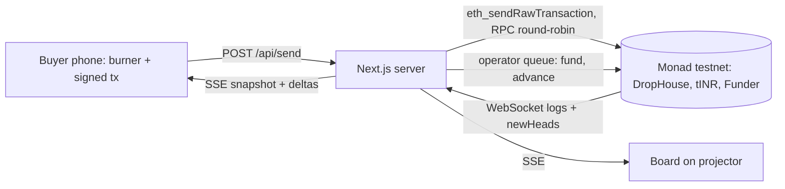

# Architecture — Dibs
Mode: hackathon. Last structural change: 2026-10-10 (planning, before the build block).

## Overview
A seller shares a drop link; buyers' phones claim pieces on Monad testnet with their own burner wallets; one Next.js
server watches the chain, pushes the line to every screen over SSE, funds wallets, relays signed transactions and runs
the keeper that rolls a piece to the next claimant when a pay window ends. The chain is the only source of truth.

## Components
| Component | Responsibility | Tech | Why it exists (requirement) | When it fails |
|---|---|---|---|---|
| DropHouse.sol | drops, claim queue, deposits, tip cap, pay window, pay, advance, withdraw | Solidity 0.8.x, Foundry, OpenZeppelin 5 | AC-1…AC-5: the order and the money must be editable by no one | revert reasons surface on the phone; nothing is half-done |
| TestRupee.sol (tINR) | ERC-20 + ERC-2612 permit; mint restricted to Funder | OpenZeppelin ERC20Permit | money moves without native value (10 MON reserve rule); one-tx claims via permit | — |
| Funder.sol | one tx sends gas MON to up to 50 burners and mints them tINR | Solidity | fund a room in seconds (AC-8, J1) | operator low on MON → `/api/health` red; presenter tops up |
| Next.js server (one process) | pages + API + indexer + keeper + operator queue | Next 16 App Router, Node runtime, viem 2 | one deployable (law 2) | process restart → indexer backfills from logs; clients reconnect |
| Indexer singleton | WebSocket `logs` + `newHeads`; backfill `getLogs` from deploy block; in-memory drop state; stats | viem `watchContractEvent`/`watchBlocks` over WebSocket, `globalThis` singleton | phones never poll the chain (RPC limits) | socket drop → reconnect + backfill from last block |
| Operator queue | one key, local nonce, serial sends: fund batches, keeper `advance()`, admin txs | viem wallet client | nonce safety; keeper (J2) | stuck nonce → resend same nonce with a higher fee within the cap |
| Send relay `/api/send` | accept a buyer's raw signed tx, forward to RPCs round-robin with retry | viem `sendRawTransaction` | spread load over public RPC limits | all RPCs fail → 502 with reason; phone retries the same signed tx |
| Buyer, board, seller pages | UI-SPEC S0–S3 | React 19, Tailwind 4, Motion, qrcode.react | the product | stream lost → greyed last state + reconnect |

## Contract interface (the agreed boundary; T02 writes it first)
```solidity
uint256 public constant MAX_TIP = 2 gwei;                    // tx.gasprice - block.basefee must be <= MAX_TIP
function createDrop(address token, uint64 startsAt, uint32 payWindow, uint96 price, uint96 deposit, uint16 pieces) returns (uint256 dropId)
function claimWithPermit(uint256 dropId, uint16 piece, uint256 permitDeadline, uint8 v, bytes32 r, bytes32 s)
function claim(uint256 dropId, uint16 piece)                 // when allowance already exists
function payWithPermit(uint256 dropId, uint16 piece, uint256 permitDeadline, uint8 v, bytes32 r, bytes32 s)
function advance(uint256 dropId, uint16 piece)              // anyone, after the holder's deadline
function withdraw(uint256 dropId, uint16 piece)             // claimants not holding a sold piece
event DropCreated(uint256 indexed dropId, address indexed seller, uint64 startsAt, uint32 payWindow, uint96 price, uint96 deposit, uint16 pieces)
event Claimed(uint256 indexed dropId, uint16 indexed piece, address indexed buyer, uint32 position)
event TurnStarted(uint256 indexed dropId, uint16 indexed piece, address indexed buyer, uint64 deadline)
event Paid(uint256 indexed dropId, uint16 indexed piece, address indexed buyer, uint96 amount)
event Forfeited(uint256 indexed dropId, uint16 indexed piece, address indexed buyer, uint96 amount)
event Refunded(uint256 indexed dropId, uint16 indexed piece, address indexed buyer, uint96 amount)
// reverts: "not started", "sold", "already claimed", "tip above cap", "not holder", "too late", "not yet", "nothing to withdraw"
```
Rules: position = queue length at claim; head = current holder index; deadline = block.timestamp + payWindow when a turn starts; pay transfers price − deposit from the holder and the full price to the seller; advance forfeits the holder's deposit to the seller; withdraw refunds a deposit to a claimant who is not the buyer once the piece is sold (and to any claimant if the queue was exhausted).

## Client transaction rules (every phone and the operator)
- Burner key in localStorage (`dibs.pk`), viem `privateKeyToAccount`; nonce tracked locally from 0 (fresh wallet).
- Explicit `gas` per call from `forge test --gas-report` + 20% (placeholder until measured: claimWithPermit 260k, payWithPermit 180k, withdraw 90k, advance 120k). Gas is charged on the limit.
- `maxPriorityFeePerGas = 1 gwei` (≤ MAX_TIP), `maxFeePerGas = 2 × latest base fee + 1 gwei` (floor base fee 100 gwei).
- Sign locally, POST the raw tx to `/api/send`; the place in line arrives from the stream, never from the response.

## Data flow


## SSE stream (`GET /api/stream?drop=1`)
`snapshot` {drop, pieces[{index, name, size, photo, price, deposit, queue[{addr, nick, block, txIndex, position, status}], head, deadline, sold, buyer}], seller {address, balance}, stats, head} · then deltas: `head` {block, receivedAt} · `claimed` · `turn` · `paid` · `forfeited` · `refunded` · `stats` {claims, firstBlock, lastBlock, spanMs, medianSendToSeenMs, tipRefused} · keep-alive comment every 15 s. Nicknames: adjective + animal from the address hash (deterministic, `lib/nick.ts`).

## External services
| Service | Used for | Failure mode | Fallback | Limits / quota |
|---|---|---|---|---|
| Monad testnet RPCs (QuickNode, Ankr, Monad Foundation) | sends, reads, logs | 429 / timeout / socket drop | rotate; retry same signed tx; reconnect + backfill | 50 / 30 / 20 rps (docs, 2026-10-10) |
| Faucet + Blitz Portal | test MON | daily caps | pool from teammates before the start | ≥ 25 MON for the operator |
| Railway (hosting) | one long-running Node process | deploy fails / sleeps | `npm start` on a laptop + `cloudflared tunnel --url http://localhost:3000` | trial credit |
| MonadVision | links per tx; contract verification (Sourcify) | site slow | tx hash still shown | — |

## Key decisions
- ADR-0001 One Next.js process on Railway, not Vercel functions: the indexer, keeper and nonce queue need one long-lived process; serverless would open one RPC socket per viewer.
- ADR-0002 Burner wallets + Funder contract, not a relayer: buyers submit their own transactions, so the chain (not our server) orders claims.
- ADR-0003 Money in a test ERC-20 with permit, not native MON: the 10 MON reserve rule reverts value transfers from small wallets; permit keeps a claim to one transaction.
- ADR-0004 Tip cap inside claim(): Monad leaders order by priority fee, so without a cap a higher fee buys a place.

## Failure boundaries
Phones degrade to "Reconnecting…" and keep their signed tx; the send relay is idempotent per tx hash; the keeper is idempotent (advance reverts "not yet" if early); a server restart rebuilds state from logs. The chain never stops; the demo stops only if every RPC is down (then the recorded take plays).

## Deployment
Contracts: `forge script` from a teammate's laptop with `DEPLOYER_PK` (local `.env`), verified on MonadVision. App: Railway service from the GitHub fork, `npm run build` / `npm start`, env vars in Railway (list in `.env.example`). Rollback: redeploy the previous Railway deployment; contracts are new deploys (addresses in env).

## Observability
`/api/health`: operator MON balance, indexer last block and lag, SSE client count, RPC error counts. Server logs one line per send (hash, RPC used, ms) and per keeper action. Board stats strip shows the same numbers.

## Known tradeoffs
Inside one 0.3 s block the leader's arrival order decides (tip-capped). A scalper who pays is not stopped. Test money only. Another fast EVM chain could run it; Monad makes it live in a room.
