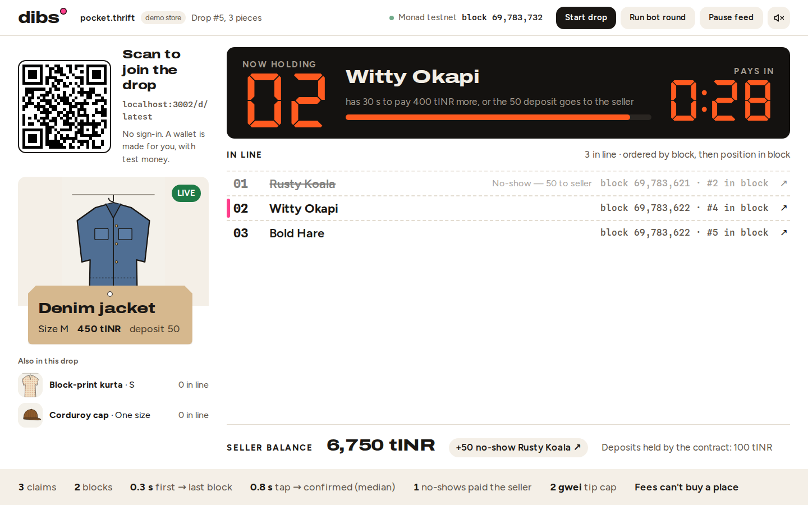

# Dibs

**Dibs: a claim link for Instagram thrift drops. Buyers tap at once, Monad records the order, and a no-show's deposit pays the seller as the item rolls to #2.**



**Live:** LIVE_URL · **Board (projector):** LIVE_URL/board/latest · **Phone:** LIVE_URL/d/latest

> You can't pay to jump this queue, the seller can't edit it, and a no-show pays for the wait.

## Judge it in 90 seconds

1. Open the board: `/board/latest`.
2. Open the drop on your phone (scan the QR on the board, or `/d/latest`). A wallet is made for you, with test money. No sign-in.
3. Tap **Dibs**. Your place appears with the block it landed in, on your phone and on the board.
4. If you're #1, don't pay. When the timer hits zero your stub tears off, your 50 tINR deposit goes to the seller, and #2 is up.
5. Presenter: **Run bot round**. 100 scripted wallets claim and abandon, every forfeit pays the seller, and one claim with a 100 gwei tip is refused on chain ("tip above cap").

## What's real, what's simulated

| | |
|---|---|
| Claims, pay, no-show forfeits, withdrawals | **Live on Monad testnet** (chain 10143), one transaction each, signed on the phone |
| Order of the line | **Chain order**: block, then position in block. Every row links to MonadVision |
| Money | **tINR, a test token** the app mints. No real rupees |
| Store | A labelled demo store ("pocket.thrift"); piece pictures are illustrations |
| Bot round | **Synthetic**: 100 generated wallets, labelled "Bot round — synthetic" on screen |
| Instagram | Not integrated. The link is what a seller would put in a story |

## How it works

- **`DropHouse.sol`** ([verified on MonadVision](https://testnet.monadvision.com/address/0x119d4dd7b665717d328dc059daa98b85e7c8302f)) keeps one line per piece. `claimWithPermit` takes a refundable deposit in one transaction and appends the buyer. The first in line holds the piece for the pay window. `payWithPermit` buys it (the deposit counts toward the price). After the window anyone can call `advance()`: the deposit goes to the seller and the next claimant's turn starts. Once a piece sells, everyone else `withdraw`s their deposit.
- **Tip cap.** Monad leaders order transactions by priority fee, so `claim` reverts with `"tip above cap"` when `tx.gasprice - block.basefee > 2 gwei`. A fee can't buy a place.
- **Money moves in tINR** ([ERC-20 + permit](https://testnet.monadvision.com/address/0x9266e65380e7f1bd5fc64a9a4f4fb9f1a6acf27c)), never native MON. Monad keeps a 10 MON reserve per account, so small wallets can't send value. **`Funder.sol`** ([verified](https://testnet.monadvision.com/address/0x3f3f1e5fb18c95736f089776352d15e9bc4149f4)) gives up to 50 phones gas MON and tINR in one transaction.
- **One Next.js server** (Railway) holds a WebSocket to Monad (`newHeads` + `logs`). It pushes the line to every screen over SSE, with a polling fallback for proxies that buffer, so phones never poll the chain. It also funds new wallets, relays the phones' signed transactions across three public RPCs, and runs the keeper that calls `advance()` when a window ends. After a restart it rebuilds state from contract views.
- **Chain time.** Monad block timestamps trail wall clocks by about a second. Drop start, countdowns and the keeper all use the last block's timestamp, not the device clock. Without this, early claims revert with "not started".

Measured on testnet today: 100 bot claims landed across 10 blocks in 2.9 s. The median from relay to the claim being seen on the stream was 0.4 s. A phone shows its place about 1.4 s after the tap.

## Run it

```bash
cp .env.example .env            # OPERATOR_PK (test key, > 12 MON), DEPLOYER_PK, PRESENTER_KEY
npm install
node scripts/check-rpc.mjs      # chain 10143, latest block, operator balance
npm run dev                     # http://localhost:3000 — board at /board/latest#key=<PRESENTER_KEY>
npm test && npm run typecheck   # unit tests (reducer, guards, keeper, tx params, reconnect)
cd contracts && forge test      # 8 tests: order by block, tip cap, forfeit, pay+withdraw, guards, permit
```

Deploy: Railway, one instance, `npm run build` / `npm start`, with the variables from `.env.example` (`railway.json` is included).
Contracts: `forge script script/Deploy.s.sol --rpc-url https://testnet-rpc.monad.xyz --broadcast` from `contracts/`. Addresses are in `deployments/testnet.json`.

## Honest limits

- It doesn't stop a scalper who is willing to pay. It stops people who never meant to pay, and it stops fee-bidding.
- Real money would need a rupee on-ramp. Everything here is testnet money.
- Another fast chain could run this. Monad's ~0.4 s blocks are what make it work live, in a room.
- Next: buyer records, so repeat no-shows put down bigger deposits.

## Built at Monad Blitz Pune V3

Planning (idea, UI spec, contract, architecture and task plan) was written before the build block; every line of code and the first commit came after it opened.

Forked from [monad-developers/monad-blitz-pune](https://github.com/monad-developers/monad-blitz-pune) as the event asks; the three template commits are the organisers'. Every commit by our team is after the build block opened.

**AI tools used:** Claude Code (Claude Opus) wrote and tested the code from the team's plan, deployed the contracts and ran the live checks. The decisions and the pitch are the team's.

### Stack

Versions checked with `npm view <pkg> version license` on 2026-10-10 (each repository URL matches the real project):

| Package | Version | License | Why |
|---|---|---|---|
| next | 16.4.0 | MIT | pages, API, SSE and the indexer in one process |
| viem | 2.57.4 | MIT | burner wallets sign on the phone; server reads/sends |
| qrcode.react | 4.2.0 | ISC | the board's join QR |
| vitest | 5.0.3 | MIT | unit tests |
| @playwright/test | 1.64.0 | Apache-2.0 | headless phones for the live checks (`scripts/burst.mjs`) |

Contracts: Foundry 1.8.5 (solc 0.8.37, EVM prague), OpenZeppelin Contracts 5.7.0 (vendored in `contracts/lib`). LED digits: DSEG7 Classic (OFL-1.1, `public/fonts`).
